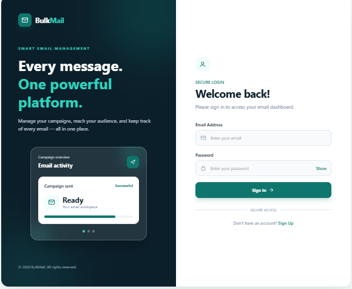
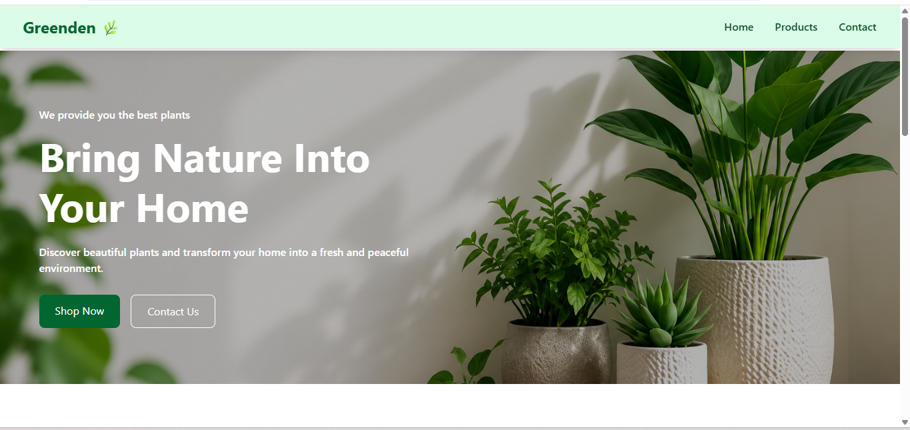
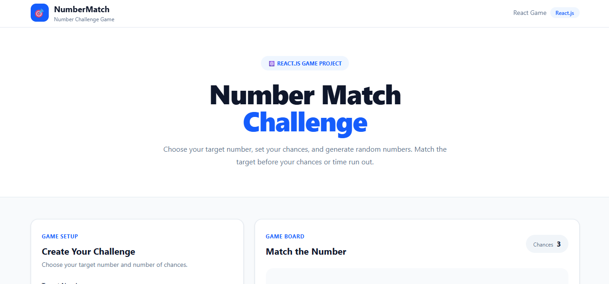

  

<h3 align="left">MERN Stack Developer · React.js · Node.js</h3>

  I build web applications with a focus on clean interfaces, practical functionality, and maintainable code. I'm continuously improving my development skills by building real-world projects and exploring new technologies.

  <a href="https://sivaraj-g-port.vercel.app/">Portfolio</a>
  &nbsp; / &nbsp;
  <a href="https://www.linkedin.com/in/sivaraj33">LinkedIn</a>
  &nbsp; / &nbsp;
  <a href="mailto:sivagovindharaj@gmail.com">Email</a>

---

<h3>01 / TECHNOLOGIES</h3>

**Frontend**

  

**Backend**

  

**Database**

  

**Tools & Platforms**

  

---

<h3>02 / SELECTED WORK</h3>

A collection of projects built while exploring frontend and full-stack development.

---

### 01. BulkMail

**Full Stack Application**

  

A MERN application for sending bulk email campaigns. Supports batch delivery through the Brevo API, duplicate removal, campaign history and dashboard analytics.

**Built with:** React · Node.js · Express.js · MongoDB · JWT · Brevo API · Tailwind CSS

- JWT authentication with Admin and User roles.
- Batch delivery of up to 500 unique recipients.
- Campaign analytics and searchable email history.

[Live Demo](https://bulk-mail-app-xi-ten.vercel.app/login) · [GitHub Repository](https://github.com/sivaraj-bit/Bulk_Mail_App)

---

### 02. Blog Portfolio

**Full Stack Application**

  

A blog and portfolio platform where visitors can explore articles and the admin can manage content through a private dashboard.

**Built with:** React · Node.js · Express.js · MongoDB · Firebase · Cloudinary · Tailwind CSS

- Category-based articles and search.
- Admin dashboard with create, edit and delete operations.
- Firebase authentication and Cloudinary image uploads.

[Live Demo](https://blog-portfolio-oq8q.vercel.app/) · [GitHub Repository](https://github.com/sivaraj-bit/Blog_Portfolio)

---

### 03. Favourite Student List

**React Application**

  

A student management application for managing student records and favourite lists.

**Built with:** React · React Router · Context API · Tailwind CSS · LocalStorage

- Add and delete student records with duplicate roll number prevention.
- Search, filter and sort student records.
- Dashboard, Student List and Favourites pages.

[Live Demo](https://fav-st-list.vercel.app/) · [GitHub Repository](https://github.com/sivaraj-bit/Fav_St_List)

---

### 04. Planora

**Frontend Application**

  

A responsive event planning application for organising events, managing budgets and tracking event statistics.

**Built with:** HTML · Tailwind CSS · JavaScript · LocalStorage

- Create and manage events.
- Search and filter by category.
- Dashboard statistics and LocalStorage persistence.

[Live Demo](https://sivaraj-bit.github.io/Smart_Event_Web/) · [GitHub Repository](https://github.com/sivaraj-bit/Smart_Event_Web)

---

### 05. Greenden

**Frontend Website**

  

A responsive three-page plant website featuring product listings and a contact form.

**Built with:** HTML · CSS · Tailwind CSS · JavaScript

- Home, Products and Contact pages.
- Product cards and popular plant sections.
- Responsive navigation and layouts.

[Live Demo](https://sivaraj-bit.github.io/Greenden_Web/) · [GitHub Repository](https://github.com/sivaraj-bit/Greenden_Web)

---

### 06. Nostra

**Frontend Website**

  

A responsive fashion shopping website with product search and combined category and rating filters.

**Built with:** HTML · CSS · JavaScript

- 32 products with prices and ratings.
- Search and category/rating filters.
- Responsive product grid and contact form validation.

[Live Demo](https://sivaraj-bit.github.io/Nostra-Wear-Your-Edge_web/) · [GitHub Repository](https://github.com/sivaraj-bit/Nostra-Wear-Your-Edge_web)

---

### 07. WeatherWise

**React Application**

  

A weather application that fetches current weather information for searched cities.

**Built with:** React · JavaScript · Tailwind CSS · Axios · OpenWeatherMap

- City-based weather search.
- Temperature, humidity, wind speed and pressure.
- Loading indicators and error handling.

[Live Demo](https://weather-app-theta-jet.vercel.app/) · [GitHub Repository](https://github.com/sivaraj-bit/Weather_App)

---

### 08. NexaFlow Login

**Authentication Application**

  

A React and Express authentication application featuring signup, login and password validation.

**Built with:** React · JavaScript · Node.js · Express.js · REST API

- Signup and login functionality.
- Password validation and show/hide password.
- Error and success messages.

[Live Demo](https://nexaflowloginpage.vercel.app/) · [GitHub Repository](https://github.com/sivaraj-bit/Nexaflow_login_page)

---

### 09. NumberMatch

**React Game**

  

A number matching game where players try to match a target number before their chances or timer run out.

**Built with:** React · JavaScript · Tailwind CSS · LocalStorage

- Random number generation and a 30-second timer.
- Win/loss conditions and attempt history.
- Score tracking with LocalStorage persistence.

[Live Demo](https://sivaraj-bit.github.io/NumberMatch-React-Game/) · [GitHub Repository](https://github.com/sivaraj-bit/NumberMatch-React-Game)

---

<h3>03 / CURRENT FOCUS</h3>

- Building full-stack applications with the MERN stack.
- Improving React and backend development skills.
- Writing cleaner, more maintainable code.

---

<h3>04 / FIND ME HERE</h3>

  <a href="https://sivaraj-g-port.vercel.app/">Portfolio</a>
  &nbsp; · &nbsp;
  <a href="https://www.linkedin.com/in/sivaraj33">LinkedIn</a>
  &nbsp; · &nbsp;
  <a href="https://github.com/sivaraj-bit">GitHub</a>
  &nbsp; · &nbsp;
  <a href="mailto:sivagovindharaj@gmail.com">Email</a>

---

  BUILDING · LEARNING · IMPROVING

