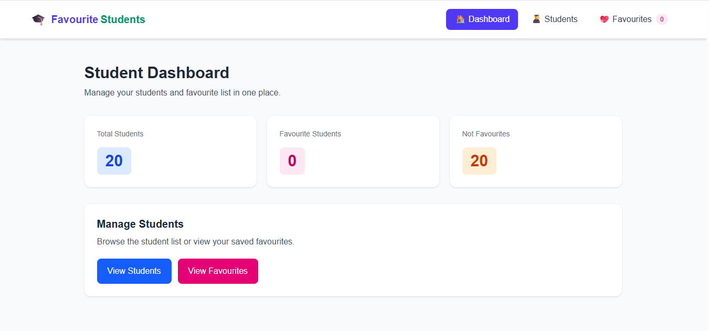
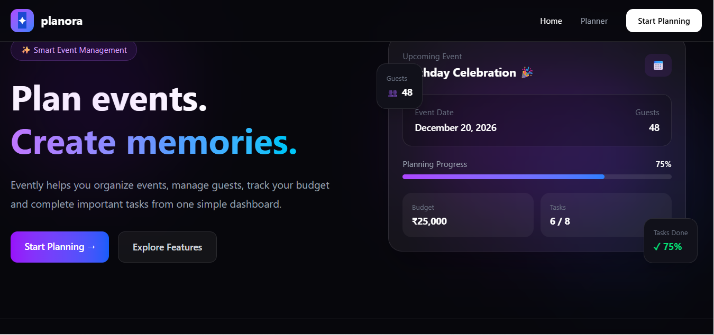
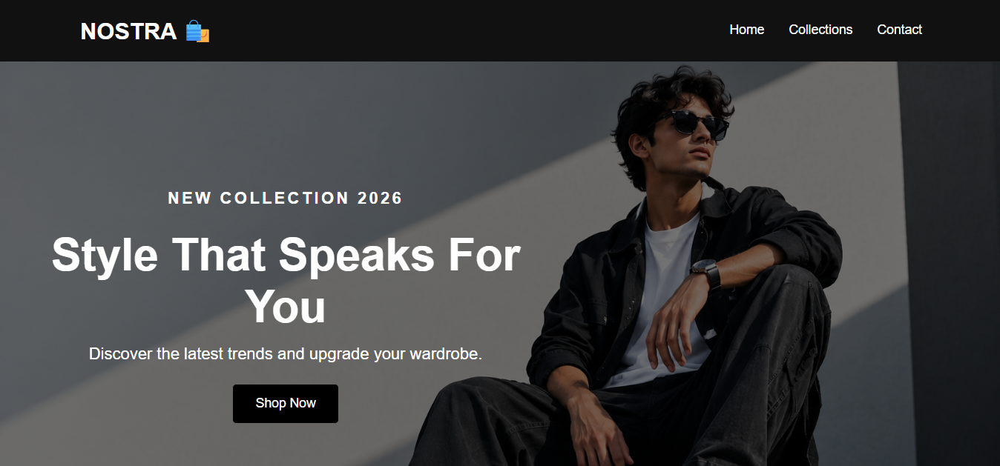
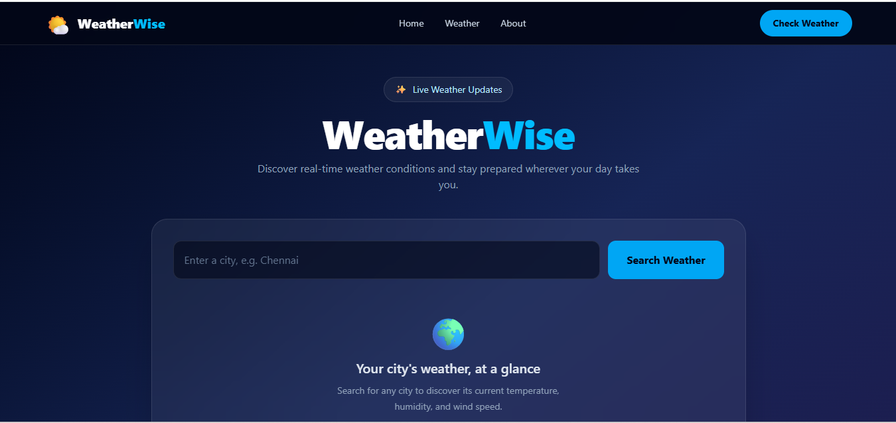
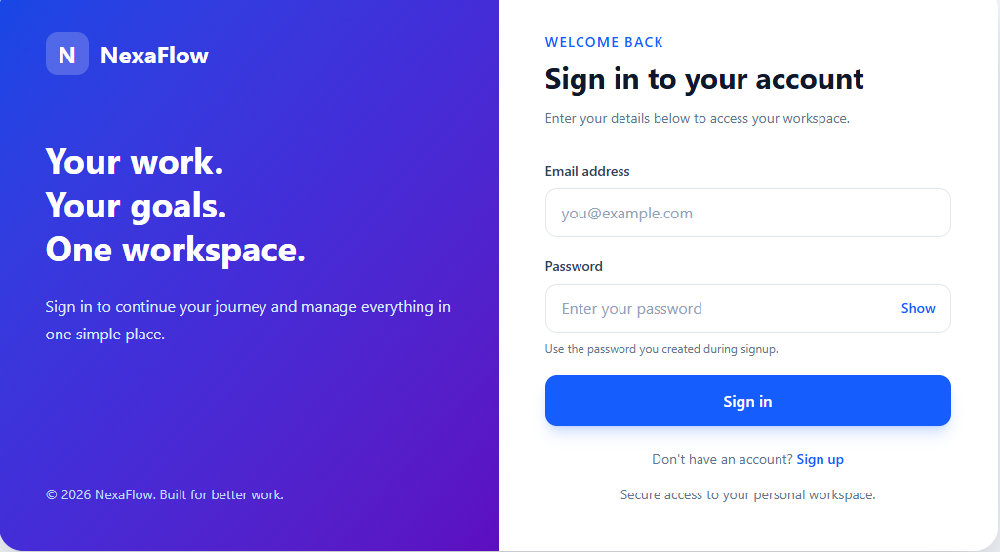

<!-- ==================== HEADER ==================== -->

  

<h3 align="center">
  MERN STACK DEVELOPER
</h3>

  React.js &nbsp;·&nbsp; Node.js &nbsp;·&nbsp; Express.js &nbsp;·&nbsp; MongoDB

  
  

 

  I build web applications with a focus on clean interfaces, practical functionality, and maintainable code. I'm continuously improving my development skills by building real-world projects and exploring new technologies.

  
  &nbsp;
  
  &nbsp;
  

 

---

<!-- ==================== TECHNOLOGIES ==================== -->

<h2 align="center">01 &nbsp; / &nbsp; TECHNOLOGIES</h2>

  TOOLS AND TECHNOLOGIES I USE TO BUILD FOR THE WEB

 

<table width="100%">
  <tr>
    <td width="50%" valign="top">
      <h3>Frontend</h3>
      
    </td>
    <td width="50%" valign="top">
      <h3>Backend</h3>
      
    </td>
  </tr>
  <tr>
    <td width="50%" valign="top">
      <h3>Database</h3>
      
    </td>
    <td width="50%" valign="top">
      <h3>Tools & Platforms</h3>
      
    </td>
  </tr>
</table>

 

---

<!-- ==================== PROJECTS ==================== -->

<h2 align="center">02 &nbsp; / &nbsp; SELECTED WORK</h2>

  A COLLECTION OF PROJECTS BUILT THROUGH PRACTICE AND EXPERIMENTATION

 

<!-- PROJECT 01 -->

<h3>01. &nbsp; BulkMail</h3>

  <strong>FULL STACK APPLICATION</strong>
  &nbsp;·&nbsp;
  CAMPAIGN MANAGEMENT

  

A MERN application for sending bulk email campaigns. Supports batch delivery through the Brevo API, duplicate removal, campaign history and dashboard analytics.

**Stack**

`React` `Node.js` `Express.js` `MongoDB` `JWT` `Brevo API` `Tailwind CSS`

- JWT authentication with Admin and User roles.
- Batch delivery of up to 500 unique recipients.
- Campaign analytics and searchable email history.

  <a href="https://bulk-mail-app-xi-ten.vercel.app/login">LIVE DEMO ↗</a>
  &nbsp;&nbsp;·&nbsp;&nbsp;
  <a href="https://github.com/sivaraj-bit/Bulk_Mail_App">SOURCE CODE ↗</a>

 

---

<!-- PROJECT 02 -->

<h3>02. &nbsp; Blog Portfolio</h3>

  <strong>FULL STACK APPLICATION</strong>
  &nbsp;·&nbsp;
  CONTENT MANAGEMENT

  

A blog and portfolio platform where visitors can explore articles and the admin can manage content through a private dashboard.

**Stack**

`React` `Node.js` `Express.js` `MongoDB` `Firebase` `Cloudinary` `Tailwind CSS`

- Category-based articles and search.
- Admin dashboard with create, edit and delete operations.
- Firebase authentication and Cloudinary image uploads.

  <a href="https://blog-portfolio-oq8q.vercel.app/">LIVE DEMO ↗</a>
  &nbsp;&nbsp;·&nbsp;&nbsp;
  <a href="https://github.com/sivaraj-bit/Blog_Portfolio">SOURCE CODE ↗</a>

 

---

<!-- PROJECT 03 -->

<h3>03. &nbsp; Favourite Student List</h3>

  <strong>REACT APPLICATION</strong>
  &nbsp;·&nbsp;
  STUDENT MANAGEMENT

  

A student management application for managing student records and favourite lists.

**Stack**

`React` `React Router` `Context API` `Tailwind CSS` `LocalStorage`

- Add and delete student records with duplicate roll number prevention.
- Search, filter and sort student records.
- Dashboard, Student List and Favourites pages.

  <a href="https://fav-st-list.vercel.app/">LIVE DEMO ↗</a>
  &nbsp;&nbsp;·&nbsp;&nbsp;
  <a href="https://github.com/sivaraj-bit/Fav_St_List">SOURCE CODE ↗</a>

 

---

<!-- PROJECT 04 -->

<h3>04. &nbsp; Planora</h3>

  <strong>FRONTEND APPLICATION</strong>
  &nbsp;·&nbsp;
  EVENT PLANNING

  

A responsive event planning application for organising events, managing budgets and tracking event statistics.

**Stack**

`HTML` `Tailwind CSS` `JavaScript` `LocalStorage`

- Create and manage events.
- Search and filter by category.
- Dashboard statistics and LocalStorage persistence.

  <a href="https://sivaraj-bit.github.io/Smart_Event_Web/">LIVE DEMO ↗</a>
  &nbsp;&nbsp;·&nbsp;&nbsp;
  <a href="https://github.com/sivaraj-bit/Smart_Event_Web">SOURCE CODE ↗</a>

 

---

<!-- PROJECT 05 -->

<h3>05. &nbsp; Greenden</h3>

  <strong>FRONTEND WEBSITE</strong>
  &nbsp;·&nbsp;
  PLANT SHOPPING

  

A responsive three-page plant website featuring product listings and a contact form.

**Stack**

`HTML` `CSS` `Tailwind CSS` `JavaScript`

- Home, Products and Contact pages.
- Product cards and popular plant sections.
- Responsive navigation and layouts.

  <a href="https://sivaraj-bit.github.io/Greenden_Web/">LIVE DEMO ↗</a>
  &nbsp;&nbsp;·&nbsp;&nbsp;
  <a href="https://github.com/sivaraj-bit/Greenden_Web">SOURCE CODE ↗</a>

 

---

<!-- PROJECT 06 -->

<h3>06. &nbsp; Nostra</h3>

  <strong>FRONTEND WEBSITE</strong>
  &nbsp;·&nbsp;
  FASHION E-COMMERCE

  

A responsive fashion shopping website with product search and combined category and rating filters.

**Stack**

`HTML` `CSS` `JavaScript`

- 32 products with prices and ratings.
- Search and category/rating filters.
- Responsive product grid and contact form validation.

  <a href="https://sivaraj-bit.github.io/Nostra-Wear-Your-Edge_web/">LIVE DEMO ↗</a>
  &nbsp;&nbsp;·&nbsp;&nbsp;
  <a href="https://github.com/sivaraj-bit/Nostra-Wear-Your-Edge_web">SOURCE CODE ↗</a>

 

---

<!-- PROJECT 07 -->

<h3>07. &nbsp; WeatherWise</h3>

  <strong>REACT APPLICATION</strong>
  &nbsp;·&nbsp;
  WEATHER INFORMATION

  

A weather application that fetches current weather information for searched cities.

**Stack**

`React` `JavaScript` `Tailwind CSS` `Axios` `OpenWeatherMap`

- City-based weather search.
- Temperature, humidity, wind speed and pressure.
- Loading indicators and error handling.

  <a href="https://weather-app-theta-jet.vercel.app/">LIVE DEMO ↗</a>
  &nbsp;&nbsp;·&nbsp;&nbsp;
  <a href="https://github.com/sivaraj-bit/Weather_App">SOURCE CODE ↗</a>

 

---

<!-- PROJECT 08 -->

<h3>08. &nbsp; NexaFlow Login</h3>

  <strong>AUTHENTICATION APPLICATION</strong>
  &nbsp;·&nbsp;
  USER AUTHENTICATION

  

A React and Express authentication application featuring signup, login and password validation.

**Stack**

`React` `JavaScript` `Node.js` `Express.js` `REST API`

- Signup and login functionality.
- Password validation and show/hide password.
- Error and success messages.

  <a href="https://nexaflowloginpage.vercel.app/">LIVE DEMO ↗</a>
  &nbsp;&nbsp;·&nbsp;&nbsp;
  <a href="https://github.com/sivaraj-bit/Nexaflow_login_page">SOURCE CODE ↗</a>

 

---

<!-- PROJECT 09 -->

<h3>09. &nbsp; NumberMatch</h3>

  <strong>REACT GAME</strong>
  &nbsp;·&nbsp;
  NUMBER MATCHING

  

A number matching game where players try to match a target number before their chances or timer run out.

**Stack**

`React` `JavaScript` `Tailwind CSS` `LocalStorage`

- Random number generation and a 30-second timer.
- Win/loss conditions and attempt history.
- Score tracking with LocalStorage persistence.

  <a href="https://sivaraj-bit.github.io/NumberMatch-React-Game/">LIVE DEMO ↗</a>
  &nbsp;&nbsp;·&nbsp;&nbsp;
  <a href="https://github.com/sivaraj-bit/NumberMatch-React-Game">SOURCE CODE ↗</a>

 

---

<!-- ==================== CURRENT FOCUS ==================== -->

<h2 align="center">03 &nbsp; / &nbsp; CURRENT FOCUS</h2>

 

<table width="100%">
  <tr>
    <td width="33%" valign="top">
      
<strong>01 / BUILD</strong>

      Building full-stack applications with the MERN stack.
    </td>
    <td width="33%" valign="top">
      
<strong>02 / IMPROVE</strong>

      Improving React and backend development skills.
    </td>
    <td width="33%" valign="top">
      
<strong>03 / REFINE</strong>

      Writing cleaner, more maintainable code.
    </td>
  </tr>
</table>

 

---

<!-- ==================== CONTACT ==================== -->

<h2 align="center">04 &nbsp; / &nbsp; LET'S CONNECT</h2>

  Interested in web development, building useful products, and learning from other developers.

  <a href="https://sivaraj-g-port.vercel.app/">PORTFOLIO</a>
  &nbsp;&nbsp;·&nbsp;&nbsp;
  <a href="https://www.linkedin.com/in/sivaraj33">LINKEDIN</a>
  &nbsp;&nbsp;·&nbsp;&nbsp;
  <a href="https://github.com/sivaraj-bit">GITHUB</a>
  &nbsp;&nbsp;·&nbsp;&nbsp;
  <a href="mailto:sivagovindharaj@gmail.com">EMAIL</a>

 

  
  
  

  DESIGNED WITH PURPOSE · BUILT THROUGH PRACTICE

